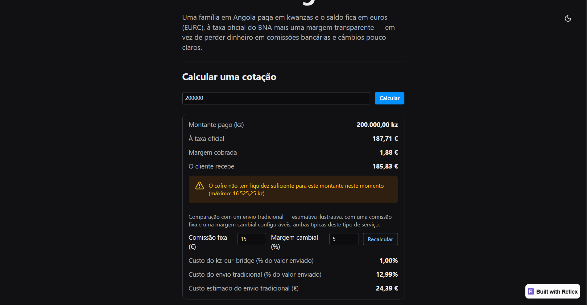

# kz-eur-bridge

**Stablecoin settlement layer for the Portugal ↔ Angola remittance corridor, built on Circle's EURC.**

An Angolan family pays in kwanzas through a local rail (Multicaixa / KWiK). Their balance is held in euros (EURC) on-chain, at the official BNA rate plus a transparent margin. From there they can pay with a card in Portugal, send money to a bank account in Europe, or transfer to another user, such as a student in Lisbon, for free.

The kwanza never touches the blockchain. It stays with a licensed Angolan partner; the smart contracts handle the euro side: pricing, custody, accounting and payouts.

> ⚠️ Testnet prototype built as a learning and portfolio project. Not audited. Not for real funds.



---

## The problem

- The kwanza is not freely convertible, and euros are scarce in Angola.
- Sending money from Angola to Portugal means bank fees plus a large FX markup. In early conversations with Angolan families in Lisbon, one reported paying **€40+ in fees per transfer**, on top of an unfavourable rate.
- Informal USDT/AOA P2P markets already exist, which shows the demand, but they are unregulated and risky.

## How it works

```
Parent in Luanda pays 50,000 kz (Multicaixa)      ← off-chain, at the Angolan partner
        │
        ▼
backend → EuroVault.creditFromKwanza()
        │   rate from EurAoaOracle: 1,065.50 AOA/EUR
        │   gross 46.93 € − 1% margin (0.47 €) = 46.46 € balance in EURC
        ▼
EUR balance ──► payout()                → card payment / SEPA transfer in Portugal
            └─► transferBetweenUsers()  → child in Lisbon (free, no tokens move)
```

## Deployed on Base Sepolia (verified)

| Contract | Address |
|---|---|
| EuroVault | [`0xaF01ae066ce87DB2cca972126E2371972a746C4f`](https://sepolia.basescan.org/address/0xaF01ae066ce87DB2cca972126E2371972a746C4f#code) |
| EurAoaOracle | [`0xB8dcA382cd3011551e0fce10e32c1d58d499E570`](https://sepolia.basescan.org/address/0xB8dcA382cd3011551e0fce10e32c1d58d499E570#code) |
| EURC (Circle, testnet) | [`0x808456652fdb597867f38412077A9182bf77359F`](https://sepolia.basescan.org/address/0x808456652fdb597867f38412077A9182bf77359F) |

The vault holds real testnet EURC issued by Circle, funded from Circle's faucet. Open it on Basescan → **Contract → Read Contract** and call `quote(5000000)` to price 50,000 kz.

## Contracts

| Contract | Responsibility |
|---|---|
| [`EurAoaOracle`](src/EurAoaOracle.sol) | Publishes the EUR/AOA rate (8 decimals). Only the authorised updater can write. Rejects moves above 5% per update and refuses to serve a rate older than 4 days. |
| [`EuroVault`](src/EuroVault.sol) | Custodial EURC vault. Converts kwanza payments into euro balances, applies the margin, pays out, and keeps itself solvent at all times. |
| [`MockEURC`](src/MockEURC.sol) | 6-decimal ERC-20 used in the local test suite only. |

## Stablecoin design notes

**Why EURC, and not USDT or USDC.** Customers spend in Portugal, in euros. A euro stablecoin means a single FX conversion (kwanza → euro, at top-up), instead of USD-denominated crypto cards that charge a second FX fee on every euro purchase. EURC is issued by Circle as an e-money token under MiCA, which matters for any EU-facing product; at the time of writing, USDT is not authorised under MiCA.

**Where the peg comes from.** Each EURC is meant to be backed 1:1 by euro reserves held by the issuer, and redeemable with Circle. The peg holds because large holders can mint and redeem at par, so any deviation is arbitraged away. That also means the peg is only as strong as the issuer's reserves and banking partners: USDC briefly lost its peg in March 2023 when part of its reserves was stuck at Silicon Valley Bank.

**Depeg risk is passed through, by design.** The vault accounts in EURC units, not in euros. If EURC traded at €0.97, customer balances would effectively be worth 3% less. A production system would need a treasury policy for this (for example, absorbing small deviations or pausing credits).

**A regulated stablecoin comes with issuer controls.** Circle's EURC is an upgradeable proxy contract, and the issuer can freeze addresses to comply with sanctions or court orders. This is visible even in gas costs: `approve` on EURC cost ~55k gas versus ~46k on the plain mock token, because every call is forwarded through the proxy. For a licensed business, this is a feature (compliance), but it is also a dependency: the vault's funds sit on a contract someone else controls.

**Liquidity is the real constraint.** Customers receive euros the moment their kwanza payment is confirmed, so the euros must be pre-funded in the vault, while the kwanzas accumulate with the Angolan partner. On this testnet the vault holds 20 EURC, so it can only accept small top-ups; the contract rejects anything larger with `InsufficientLiquidity`. In production, this is the core business problem: netting opposite flows (Portugal → Angola) and rebalancing between partners.

**Why an L2.** A credit costs ~136k gas. On Base, at the gas prices seen during deployment (~0.006 gwei), that is a tiny fraction of a cent. With a 1% margin, a 50,000 kz top-up earns about €0.47, so network costs must be negligible for the model to work.

**What stays off-chain, and why.** The kwanza leg, KYC/AML, licensing and BNA reporting. The BNA reference rate itself is published as informative, so in production the rate would come from the FX partner that actually executes the conversion.

## Design decisions

**Solvency invariant.** `EURC held by the vault ≥ totalLiabilities` at all times. Credits only proceed if there is free liquidity, and the treasury can only withdraw what does not belong to customers. Fuzz tests check this after random credits, payouts and withdrawals.

**Convert on top-up, not on spend.** Once kwanzas are paid in, the customer's balance is in euros and stops losing value to kwanza depreciation.

**The contract computes, the backend reports.** The backend only says "user X paid Y kwanzas". The vault prices it with the oracle, so a compromised or buggy backend cannot credit arbitrary euro amounts.

**Idempotency.** Every credit, payout and transfer carries a unique reference (for example the Multicaixa reference). Retrying after a network error can never credit or pay twice. A reverted operation does not consume its reference.

**Slippage protection.** The user accepts a quoted amount (`minNet`). If the rate moves against them before execution, the credit reverts instead of silently paying less.

**Bounded margin.** `MAX_SPREAD_BPS = 500` is a `constant`: not even the operator can charge more than 5%.

**Oracle safety.** No Chainlink feed exists for EUR/AOA, so the oracle is custom. A deviation cap stops typos and attacks; a staleness check stops the vault from converting at an outdated rate.

**Checks-effects-interactions.** State and events are updated before any external token call. Custom errors and an `onlyOperator` modifier keep the code cheaper and the access rules visible in every function signature.

## Tests

40 tests, including 4 fuzz tests.

```bash
forge test
forge test --match-test testFuzz --fuzz-runs 10000
forge coverage
forge test --gas-report
```

| Area | What is tested |
|---|---|
| Oracle | access control, deviation up and down, staleness, zero rate, events |
| Credits | conversion maths, margin, liquidity limits, stale oracle propagation |
| Quotes | exact quote, rate moving against / in favour of the user |
| Idempotency | reused references on credits and payouts, empty refs, reverted credits not burning refs |
| Treasury | profit withdrawal, never touching customer funds |
| Transfers | balances, conservation of total liabilities, self-transfer |
| Events | every state-changing operation emits the expected event |
| Fuzz | solvency after credits, payouts and withdrawals; conservation on transfers |

### Gas (optimizer on, 200 runs)

| Operation | Avg gas |
|---|---|
| `creditFromKwanza` | ~136k |
| `payout` | ~93k |
| `transferBetweenUsers` | ~76k |
| `quote` (view) | ~15k, free off-chain |

Turning the optimizer on halved deployment cost, but only cut per-call cost by 2–4%: most of the cost of each call is storage writes (reference + balance), which the optimizer cannot remove.

## Demo app (Reflex)

A read-only page in [`app/`](app/), written in Python with [Reflex](https://reflex.dev) and web3.py. It never holds a private key and never sends transactions.

- Quote any kwanza amount against the live vault (official rate, margin, what the customer receives).
- Compare the effective cost (% of the amount sent) with a traditional transfer, using configurable, illustrative assumptions.
- See the vault's live balance sheet: free liquidity, total owed to customers, fees collected, margin and rate freshness.
- Friendly handling of a stale oracle (`StaleRate`) and RPC errors.

```bash
python -m venv .venv
source .venv/Scripts/activate      # Windows / Git Bash
pip install reflex web3 python-dotenv
cd app
cp .env.example .env
reflex run                         # http://localhost:3000
```

## Smart contracts: run and deploy

Requires [Foundry](https://book.getfoundry.sh/).

```bash
git clone <this repo> --recurse-submodules
cd kz-eur-bridge
forge build
forge test
```

Deploy to Base Sepolia with Circle's EURC (the deployer wallet must hold testnet EURC from [Circle's faucet](https://faucet.circle.com); all of it is deposited as vault liquidity):

```bash
cp .env.example .env            # add your ETHERSCAN_API_KEY
cast wallet import deployer --interactive
set -a; source .env; set +a

forge script script/DeployEURC.s.sol --rpc-url base_sepolia \
  --account deployer --sender <your-address> --broadcast --verify
```

`script/Deploy.s.sol` deploys the same contracts with the mock token instead.

### Interact with `cast`

```bash
VAULT=0xaF01ae066ce87DB2cca972126E2371972a746C4f
ORACLE=0xB8dcA382cd3011551e0fce10e32c1d58d499E570

# Price 5,000 kz (free)
cast call $VAULT "quote(uint256)(uint256,uint256,uint256)" 500000 --rpc-url base_sepolia

# Credit user 1 (operator only)
cast send $VAULT "creditFromKwanza(uint256,uint256,uint256,bytes32)" \
  1 500000 0 $(cast format-bytes32-string "MCX-0002") \
  --rpc-url base_sepolia --account deployer

# Refresh the rate (updater only; the oracle refuses rates older than 4 days)
cast send $ORACLE "updateRate(uint256)" 106550000000 --rpc-url base_sepolia --account deployer
```

## Known limitations

- **Centralised trust.** A single operator key controls credits, payouts and the margin, and a single updater controls the rate. Production would need role separation, multisig and timelocks.
- **Custodial.** Users have no wallet; balances are internal accounting keyed by user ID.
- **No pause switch yet**, and no admin path to handle an official devaluation above the 5% cap.
- **User IDs are plain integers.** They should be hashed internal IDs so balances cannot be linked to people.
- **Manual rate updates.** On the testnet, `updateRate` is called by hand.
- **`totalFeesCollected` is stored on-chain**, costing ~5k gas per credit; it could be derived off-chain from events.

## Regulatory context

The design assumes licensed partners on both sides: an e-money / payment institution in Portugal (MiCA-compliant EURC on the EU side) and a BNA-licensed bank or wallet in Angola for the kwanza leg, where every FX operation by a resident is subject to annual limits and reporting. Per-operation references and events make every movement traceable for that reporting; enforcing per-user annual limits on-chain is on the roadmap.

## Roadmap

- [x] Deploy with Circle's EURC instead of a mock token
- [x] Read-only demo page
- [ ] Pause switch and role separation (operator, treasury, rate updater)
- [ ] Hashed user IDs
- [ ] Per-user annual limits mirroring BNA rules
- [ ] Invariant tests (random sequences of operations)
- [ ] Rate-updater service
- [ ] Portugal → Angola direction and netting of opposite flows
